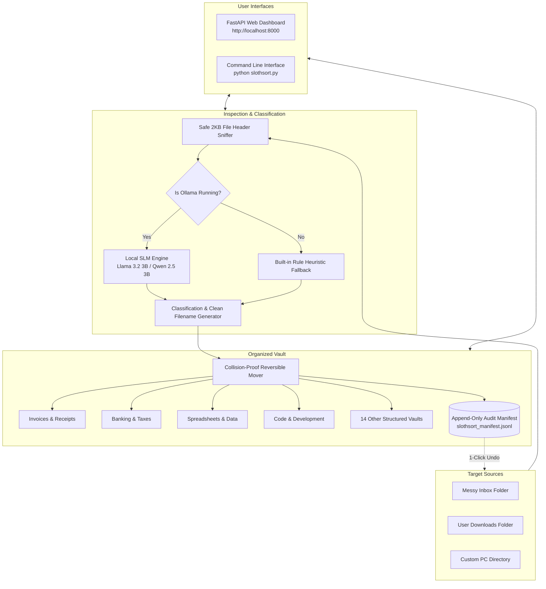

# SlothSort

<p align="center">
  <strong>Autonomous Local AI File & Clutter Tidier powered by Open-Weight Models.</strong><br>
  <em>100% Offline • Zero Cloud Egress • Zero Marginal Token Fees • Complete Reversibility</em>
</p>

<p align="center">
  
  
  
  
  
  
</p>

---

## 📑 Table of Contents

- [The Problem & The Vision](#-the-problem--the-vision)
- [Why Local Open-Weight AI Matters](#-why-local-open-weight-ai-matters)
- [How SlothSort Works (Under the Hood)](#-how-slothsort-works-under-the-hood)
- [Key Features](#-key-features)
- [System Architecture](#-system-architecture)
- [The 18 Built-in Semantic Domains](#-the-18-built-in-semantic-domains)
- [Supported Local AI Models](#-supported-local-ai-models)
- [Installation & Quickstart](#-installation--quickstart)
  - [Prerequisites](#1-prerequisites)
  - [Setup & Installation](#2-setup--installation)
  - [Running the Web Dashboard](#3-running-the-web-dashboard)
- [Command Line Interface (CLI)](#-command-line-interface-cli)
- [REST API Reference](#-rest-api-reference)
- [Security, Privacy & Safety Guarantees](#-security-privacy--safety-guarantees)
- [Project Structure](#-project-structure)
- [Troubleshooting & FAQ](#-troubleshooting--faq)
- [License & Acknowledgements](#-license--acknowledgements)

---

## 💡 The Problem & The Vision

Every developer, knowledge worker, and student knows the **"Downloads Folder Graveyard."** Over weeks and months, our default download and desktop directories become chaotic dumping grounds for hundreds of files:

```
Downloads/
├── download (1).pdf           <-- Actually a quarterly cloud compute invoice
├── scan_0042.jpg              <-- Prescription blood test lab results
├── W2_Tax_Year_2025.txt       <-- Personal income tax statement
├── untitled_notes_oct.md      <-- Stealth startup technical pitch notes
├── docker-compose.prod.yaml   <-- Production server orchestration config
└── NDA_client_v2_final.docx   <-- Mutual legal confidentiality contract
```

Manual categorization is mental friction that everyone procrastinates on. Yet, automating this with traditional cloud AI services (e.g., OpenAI, Anthropic, Google Cloud) presents fatal flaws:

1. **Catastrophic Privacy Exposure**: Feeding tax filings, contracts, and medical records to remote commercial APIs violates personal privacy and enterprise compliance.
2. **Token Cost Anxiety**: Continuous daemon processes checking files create compounding API costs.
3. **No Offline Support**: Cloud-dependent tools stop functioning on flights, trains, or off-grid remote work environments.

**SlothSort** solves this cleanly: it runs **100% locally** using quantized open-weight Small Language Models (SLMs) such as `Llama 3.2 3B` or `Qwen 2.5 3B` via [Ollama](https://ollama.com/). It reads files safely, reasons about their actual contents, generates standardized date-stamped filenames, and sorts them into organized vault structures—with **zero cloud egress** and **1-click reversible undo**.

---

## 🔒 Why Local Open-Weight AI Matters

| Feature | Cloud Commercial APIs (Closed) | SlothSort with Local SLMs (Open-Weight) |
| :--- | :--- | :--- |
| **Data Privacy** | Sensitive files leave your computer and hit third-party servers | **100% Private**: Not a single byte ever leaves your local machine |
| **Operating Cost** | Recurring token billing per API call | **$0.00 Forever**: Free unlimited local inference |
| **Network Dependency** | Requires active, low-latency internet connection | **Air-Gapped Ready**: Works offline on airplanes or off-grid |
| **Auditability** | Black-box proprietary endpoints | Full control over model weights, prompts, and inference logic |
| **Safety & Rollback** | File moves are permanent unless custom scripts are written | **Append-only audit trail** with instant 1-click reversibility |

---

## ⚙️ How SlothSort Works (Under the Hood)

SlothSort operates through a 5-stage safe pipeline:

### 1. Safe 2KB Header Sniffing (Memory-Bounded)
SlothSort never loads massive files into memory. It inspects only the first **2,048 bytes** (headers, MIME signatures, shebangs, document preludes, or metadata snippets). A 5GB disk image or video file will never freeze your machine.

### 2. Neural Intent Reasoning (Open-Weight SLM)
The extracted snippet is passed to a quantized local model (`llama3.2:3b`, `qwen2.5:3b`, etc.) hosted via Ollama's local HTTP API (`http://localhost:11434`). The model is instructed with strict JSON schema constraints to return:
- **`predicted_category`**: Which of the 18 semantic vault categories it belongs to.
- **`suggested_name`**: A clean, normalized, date-stamped title (e.g. `2026-10-22_AWS_Cloud_Invoice.pdf`).
- **`reasoning`**: A concise one-sentence explanation of why this classification was chosen.
- **`tags`**: 2–4 searchable topical tags.

### 3. High-Accuracy Deterministic Fallback Engine
If Ollama is not installed or currently stopped, SlothSort **does not fail**. It seamlessly switches to a built-in deterministic heuristic rule engine that inspects binary signatures, file extensions, and regex patterns to ensure 100% uninterrupted operation.

### 4. Collision-Proof Reversible Move
Files are moved into target categorized vault subdirectories. If a target filename already exists, SlothSort automatically adds collision-prevention suffixes (`_1`, `_2`) so files are never overwritten or corrupted.

### 5. Append-Only Audit Manifest (`slothsort_manifest.jsonl`)
Every single sorted file operation writes a JSON line containing:
- Original source path & target vault path
- Accurate timestamp
- File SHA-256 / size
- AI reasoning and confidence score
This audit trail enables **instant, deterministic 1-click undo** that moves all files back to their exact original locations.

---

## 🎨 Key Features

### 🖥️ Modern Viewport-Fitted Web Dashboard
- **Zero Window Scroll**: Engineered to strictly fit within `100vh` across various screen sizes. Only inner file lists scroll.
- **Dark Glassmorphic Aesthetic**: Curated color palette (emerald, amber, cyan, purple), subtle glass backdrops (`backdrop-filter: blur`), and clean typography using Google Fonts (*Outfit* and *JetBrains Mono*).
- **Consolidated Control Bar**: Combines sorting controls (`⚡ Sort Now`, `👁️ Dry Run`, `↩ Undo`, `🎲 Seed Demo`) with live inline metrics.

### ⚡ Dense, Compact File Tiles
- Individual file cards are streamlined down to **~38px–42px** height.
- Two-line layout:
  - **Line 1**: Checkbox, category icon, bold filename, original filename chip, file size, and quick action buttons.
  - **Line 2**: Truncated AI reasoning snippet (`💡 ...`) and clickable hashtag chips.
- Allows **10–15+ files** to be viewed simultaneously without scrolling.

### 📂 Universal Folder Support
- Switch between **Demo Sandbox** (`./messy_inbox`), your personal **Downloads** folder (`~/Downloads`), **Desktop**, **Documents**, or **any arbitrary folder on your PC**.
- Path normalization supports Windows drive letters (`D:\...`, `C:\...`) and Unix paths (`/...`, `~/...`).

### 👁️ Rich In-App Previews & Actions
- **Modal Previewer**: Inspect syntax-highlighted code, rendered Markdown, plain text snippets, or full-resolution image previews directly in the browser.
- **Micro Actions**: Instant 1-click clipboard path copy, manual category re-assignment, file renaming, single-file download, and deletion.

### 📦 Batch Operations
- Multi-select files across categories.
- Move selected files into another category in one action.
- Download selected files bundled into an automated **ZIP archive**.
- Batch delete files safely.

### 📟 Docked Collapsible Terminal
- Bottom status bar displays a live single-line ticker of the local AI engine.
- Expands via `▲ / ▼` into an audit terminal log without breaking page geometry.

---

## 🏛️ System Architecture



---

## 🗂️ The 18 Built-in Semantic Domains

SlothSort organizes documents into 18 purpose-built directory vaults:

| # | Category | Target Documents & File Types | Example Normalized Name |
| :-: | :--- | :--- | :--- |
| 1 | **🧾 Invoices & Receipts** | Invoices, bills, purchase orders, subscriptions (`.pdf`, `.txt`) | `2026-10-22_Cloud_Compute_Invoice.txt` |
| 2 | **💰 Banking & Taxes** | W-2s, 1099s, bank statements, tax returns, audits (`.pdf`, `.csv`) | `2026-10-22_Tax_Filing_Statement.txt` |
| 3 | **📊 Spreadsheets & Data** | Financial models, CSV exports, Excel sheets (`.xlsx`, `.csv`, `.tsv`) | `2026-10-22_Q3_SaaS_Financial_Model.csv` |
| 4 | **⚖️ Legal & Contracts** | NDAs, agreements, terms of service, compliance filings (`.pdf`, `.docx`) | `2026-10-22_Mutual_NDA_Contract.txt` |
| 5 | **🎓 Research & Academic** | ArXiv papers, scientific journals, dissertations, citations (`.pdf`, `.bib`) | `2026-10-22_Attention_Is_All_You_Need.pdf` |
| 6 | **💻 Code & Development** | Source code, scripts, notebooks, patches (`.py`, `.js`, `.rs`, `.go`) | `2026-10-22_Data_Pipeline_Script.py` |
| 7 | **📝 Notes & Ideas** | Meeting minutes, brain dumps, daily journals, logs (`.md`, `.txt`) | `2026-10-22_Standup_Meeting_Notes.md` |
| 8 | **🩺 Personal & Health** | Medical lab reports, prescriptions, insurance cards, fitness logs | `2026-10-22_Clinical_Lab_Report.txt` |
| 9 | **🎨 Media & Images** | Diagrams, photos, illustrations, icons (`.png`, `.jpg`, `.svg`, `.webp`) | `2026-10-22_Architecture_Diagram.svg` |
| 10 | **📽️ Presentations & Slides** | Pitch decks, lecture slides, keynote exports (`.pptx`, `.key`, `.pdf`) | `2026-10-22_Product_Pitch_Deck.txt` |
| 11 | **📚 E-Books & Manuals** | Technical guides, user manuals, documentation, epubs (`.epub`, `.pdf`) | `2026-10-22_LLM_Deployment_Guide.txt` |
| 12 | **✈️ Travel & Bookings** | Flight tickets, hotel confirmations, boarding passes, itineraries | `2026-10-22_Flight_Travel_Itinerary.txt` |
| 13 | **📜 Resumes & Credentials** | CVs, resumes, certificates, recommendation letters, diplomas | `2026-10-22_Professional_Resume_CV.txt` |
| 14 | **⚙️ Configs & System Logs** | Dockerfiles, YAML configs, `.env` templates, server logs | `2026-10-22_Docker_Production_Config.yaml` |
| 15 | **📦 Archives & Installers** | ZIPs, tarballs, installation packages (`.zip`, `.tar.gz`, `.exe`, `.dmg`) | `2026-10-22_Release_Archive_v1.zip` |
| 16 | **🎵 Audio & Podcasts** | Voice memos, podcast episodes, audio samples (`.mp3`, `.wav`, `.m4a`) | `2026-10-22_Team_Standup_Voice_Memo.txt` |
| 17 | **📁 Work & Documents** | General office documents, executive memos, proposals (`.docx`, `.odt`) | `2026-10-22_Project_Milestone_Plan.docx` |
| 18 | **🗃️ Miscellaneous** | Unidentified or multi-purpose files awaiting manual tag | `2026-10-22_Unclassified_Document.txt` |

---

## 🧠 Supported Local AI Models

SlothSort is optimized for compact, instruction-tuned open-weight models that execute with minimal memory and compute requirements:

| Model | Memory (VRAM/RAM) | Key Strengths | Pull Command |
| :--- | :---: | :--- | :--- |
| **Llama 3.2 3B** *(Recommended)* | **~2.0 GB** | Fast token generation, precise semantic extraction, low memory footprint | `ollama run llama3.2:3b` |
| **Qwen 2.5 3B** | **~1.9 GB** | Superior multilingual processing & technical coding document reasoning | `ollama run qwen2.5:3b` |
| **Phi-3.5 Mini (3.8B)** | **~2.2 GB** | Exceptional strict JSON schema compliance & structured output | `ollama run phi3:mini` |
| **Mistral 7B** | **~4.1 GB** | Deep semantic understanding for dense legal contracts & research papers | `ollama run mistral:7b` |

---

## 🚀 Installation & Quickstart

### 1. Prerequisites
- **Python 3.9 or higher**
- *(Optional, recommended)* **[Ollama](https://ollama.com/)** for running local open-weight models

If using Ollama, pull a lightweight model:
```bash
ollama run llama3.2:3b
```

### 2. Setup & Installation
Clone the repository and install the lightweight dependencies:
```bash
git clone https://github.com/your-username/slothsort.git
cd slothsort

# Optional: Create and activate a virtual environment
python -m venv .venv
# On Windows:
.venv\Scripts\activate
# On Linux/macOS:
source .venv/bin/activate

# Install requirements (FastAPI, Uvicorn, Requests, Pydantic)
pip install -r requirements.txt
```

### 3. Running the Web Dashboard
Start the local server:
```bash
python app.py
```
Open **`http://127.0.0.1:8000`** in any web browser.

---

## 💻 Command Line Interface (CLI)

SlothSort features a standalone, fully featured CLI (`slothsort.py`) that can be scheduled via `cron`, Windows Task Scheduler, or executed directly from the terminal.

```bash
# 1. Populate demo files into inbox and preview sorting without moving (Dry Run)
python slothsort.py --seed --dry-run

# 2. Execute active sorting using local AI
python slothsort.py

# 3. Clean your real Downloads folder into a designated vault
python slothsort.py --inbox ~/Downloads --vault ~/OrganizedVault

# 4. Use a specific local model
python slothsort.py --model qwen2.5:3b

# 5. Run purely with offline deterministic rule heuristics (No Ollama needed)
python slothsort.py --mock

# 6. Revert the last sorting run completely
python slothsort.py --undo
```

### CLI Command Options
| Option | Argument | Description | Default |
| :--- | :--- | :--- | :--- |
| `--inbox` | `<path>` | Path to directory containing files to tidy | `./messy_inbox` |
| `--vault` | `<path>` | Destination vault folder for categorized output | `./organized_vault` |
| `--model` | `<name>` | Ollama model name | `llama3.2:3b` |
| `--dry-run` | *None* | Perform dry run (preview names & categories without moving) | `False` |
| `--seed` | *None* | Populate 17 realistic clutter files into the inbox | `False` |
| `--mock` | *None* | Force offline rule-based heuristic inference | `False` |
| `--undo` | *None* | Revert previous sorting run using `slothsort_manifest.jsonl` | `False` |

---

## 🔌 REST API Reference

SlothSort includes an open REST API powered by FastAPI for headless scripting or integrations:

| Method | Endpoint | Description | Query / Body Parameters |
| :--- | :--- | :--- | :--- |
| `GET` | `/api/state` | Retrieve current inbox files, vault categories, active engine, and counts | None |
| `POST` | `/api/sort` | Trigger sorting run | `?dry_run=true\|false&model=llama3.2:3b` |
| `POST` | `/api/undo` | Undo previous sorting batch | None |
| `POST` | `/api/seed` | Seed realistic demo files in inbox | None |
| `POST` | `/api/set-target` | Switch active inbox and vault paths | JSON: `{"inbox_path": "...", "vault_path": "..."}` |
| `POST` | `/api/upload` | Upload multiple files to current inbox | Form multipart file upload |
| `GET` | `/api/file-content` | Preview file content safely | `?path=<filepath>` |
| `GET` | `/api/file-download` | Direct file download | `?path=<filepath>` |
| `POST` | `/api/file-action` | Single file management | JSON: `{"action": "copy\|move\|rename\|delete", "path": "...", ...}` |
| `POST` | `/api/batch-action` | Batch file management | JSON: `{"action": "move\|delete\|zip", "paths": [...]}` |
| `POST` | `/api/create-category`| Create custom vault category folder | JSON: `{"category_name": "..."}` |
| `GET` | `/api/vault/export` | Download audit manifest as JSONL | None |

---

## 🛡️ Security, Privacy & Safety Guarantees

- **No Remote Calls**: The codebase has zero telemetry or third-party cloud SDKs. All requests are addressed to `127.0.0.1`.
- **Bounded Buffer Scans**: Files are never loaded wholly into memory. Only the first 2KB snippet is read to ensure system responsiveness.
- **Audit Logging**: Every operation is logged to an immutable, append-only JSONL manifest.
- **Collision Resistance**: Existing files are never silently replaced; incremental timestamp indices prevent overwriting.
- **Deterministic Reversibility**: Any move can be completely reverted to its original path and timestamp.

---

## 📂 Project Structure

```
slothsort/
├── app.py                     # FastAPI web server, REST API endpoints, & file operations
├── slothsort.py               # Core local AI engine, Ollama client, heuristics, & CLI
├── requirements.txt           # Minimal Python dependencies
├── LICENSE                    # MIT License
├── README.md                  # Comprehensive documentation
├── messy_inbox/               # Default input folder for messy clutter
│   └── .gitkeep
├── organized_vault/           # Default output directory with categorized subvaults
│   └── slothsort_manifest.jsonl
└── static/                    # Frontend Web Dashboard (Vanilla HTML5 / CSS3 / ES6)
    ├── index.html             # Viewport-fitted semantic HTML interface
    ├── style.css              # Custom dark glassmorphic design system
    └── app.js                 # Reactive client application logic & state sync
```

---

## ❓ Troubleshooting & FAQ

#### Q: Does SlothSort require a GPU?
**A:** No. Lightweight models like `Llama 3.2 3B` and `Qwen 2.5 3B` run easily on modern multi-core laptop CPUs (Apple Silicon M-series, Intel Core i5/i7/i9, AMD Ryzen) taking ~2GB of RAM.

#### Q: What happens if Ollama is not installed or turned off?
**A:** SlothSort automatically falls back to its built-in offline deterministic rule engine. You can test and sort files without running Ollama by using the `--mock` flag or selecting the fallback mode in the dashboard.

#### Q: Can I run SlothSort on my real Downloads folder safely?
**A:** Yes. Select **"My Downloads (~/Downloads)"** from the target dropdown or pass `--inbox ~/Downloads`. We recommend running **"Dry Run"** first to inspect the proposed names and categories before committing. If you ever change your mind, click **"Undo Last Sort"** to instantly revert every file.

#### Q: How does SlothSort handle large videos or zip files?
**A:** SlothSort reads only the first 2,048 bytes of any file. It identifies video, archive, and executable container headers without loading multi-gigabyte files into memory.

---

## 📄 License

This project is open-source and released under the **[MIT License](LICENSE)**.

---

<p align="center">
  <em>Built with open-weight models for privacy, autonomy, and the joy of a clean workspace.</em>
</p>
