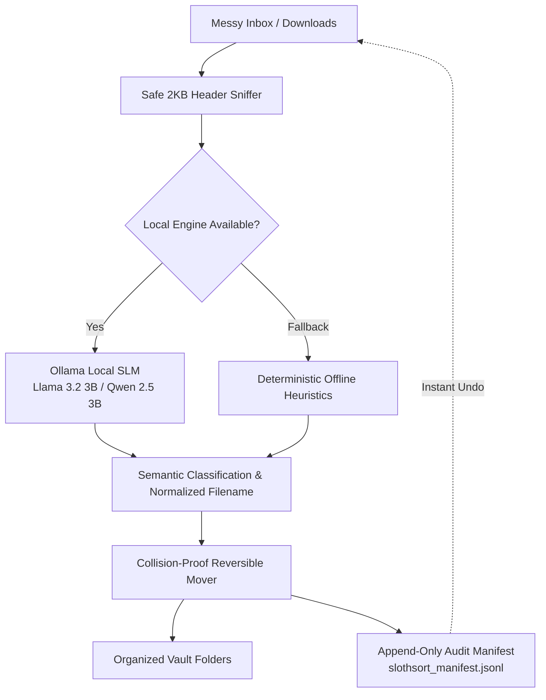

# SlothSort 🦥

<p align="center">
  <strong>Autonomous Local AI File & Clutter Tidier powered by Open-Weight Models.</strong><br>
  <em>100% Offline • Zero Cloud Egress • Zero Marginal Token Fees • Complete Reversibility</em>
</p>

<p align="center">
  
  
  
  
  
  
</p>

---

## 🌟 Overview

Everyone's `Downloads` and `Desktop` folders quickly deteriorate into digital landfills filled with cryptic files like `download (1).pdf`, `scan_0042.jpg`, or `W2_Tax_Year_2025.txt`. 

Organizing files manually is tedious, but sending your files to commercial cloud AI APIs creates serious **privacy violations** (leaking bank statements, client NDAs, tax filings, or API keys) and recurring subscription fees.

**SlothSort** solves this by letting you channel your inner sloth. It is an autonomous local file and clutter organizer powered by compact open-weight models (`Llama 3.2 3B`, `Qwen 2.5 3B`, `Phi-3.5 Mini`, `Mistral 7B` via [Ollama](https://ollama.com/)):
- **Safely reads 2KB snippets** of text, document headers, code, or metadata locally.
- **Understands document intent** and infers the category and date-stamped filename (e.g. `2026-10-22_Cloud_Compute_Invoice.pdf`).
- **Moves files into organized vault categories** with collision prevention.
- **Maintains an audit manifest** (`slothsort_manifest.jsonl`) for instant 1-click reversible undo.

---

## 🚀 Key Features

- 🖥️ **Modern Dark Glassmorphic Web Dashboard**: Viewport-fitted (`100vh`) single-page application with real-time engine streaming, compact dual-column layout, and docked collapsible terminal.
- ⚡ **Compact, High-Density File Tiles**: Sleek two-line cards with quick-action buttons for copying portable paths, moving categories, renaming, downloading, inspecting, and deleting.
- 📦 **Batch Vault Management**: Select multiple sorted files to batch-move across categories, batch-delete, or download together as a single ZIP archive.
- 📂 **Any Folder on Your PC**: Organize your `Downloads`, `Desktop`, `Documents`, or any custom path on Windows, macOS, or Linux with absolute-path auto-resolution.
- 🛡️ **Dual-Engine Architecture (Zero-Dependency Fallback)**: Runs with local Ollama open-weight SLMs, with automatic fallback to built-in deterministic heuristic rule engines if Ollama isn't running.
- 🔒 **100% Local & Air-Gapped**: Zero telemetry. Not a single byte leaves your computer. Works seamlessly without an internet connection.
- ↩️ **Reversible Safe Move**: Every single file operation is logged into an append-only JSONL audit manifest. Revert an entire sorting run with a single click or CLI flag.
- 🗂️ **18 Built-in Semantic Domains**: Invoices, Banking & Taxes, Spreadsheets, Legal, Research, Code, Notes, Personal & Health, Media, Presentations, E-Books, Travel, Resumes, System Configs, Archives, Audio & Podcasts, Work, and Miscellaneous.

---

## 🏗️ Architecture



---

## 🛠️ Quickstart

### 1. Prerequisites
- **Python 3.9+**
- *(Optional, recommended for AI reasoning)* **[Ollama](https://ollama.com/)**

Pull the recommended lightweight model (~2.0 GB VRAM/RAM):
```bash
ollama run llama3.2:3b
```
*(Alternatively, `qwen2.5:3b`, `phi3:mini`, or `mistral:7b` work out of the box).*

### 2. Clone & Install
```bash
git clone https://github.com/your-username/slothsort.git
cd slothsort
pip install -r requirements.txt
```

### 3. Launch Web Dashboard
```bash
python app.py
```
Open **`http://127.0.0.1:8000`** in your browser.

---

## 💻 Command Line Interface (CLI)

Prefer the terminal? SlothSort has a complete CLI:

```bash
# Seed realistic demo files and dry-run (preview without moving)
python slothsort.py --seed --dry-run

# Run active sorting with your local model
python slothsort.py

# Sort a specific folder (e.g., your real Downloads folder)
python slothsort.py --inbox ~/Downloads --vault ~/OrganizedVault

# Use deterministic local rule heuristics (no Ollama required)
python slothsort.py --mock

# Undo the last sorting batch
python slothsort.py --undo
```

### CLI Arguments
| Flag | Description | Default |
| :--- | :--- | :--- |
| `--inbox <path>` | Source directory of messy files to organize | `./messy_inbox` |
| `--vault <path>` | Destination vault directory | `./organized_vault` |
| `--model <name>` | Local Ollama model name | `llama3.2:3b` |
| `--dry-run` | Preview categorization and proposed names without moving files | `False` |
| `--seed` | Populate realistic test files in inbox for immediate evaluation | `False` |
| `--mock` | Force offline rule-based heuristics without calling Ollama | `False` |
| `--undo` | Revert the last sorting run using the manifest audit trail | `False` |

---

## 🧠 Supported Local Models

SlothSort is designed for lightweight, quantized open-weight models that run smoothly on laptops with CPUs or integrated GPUs:

| Model | Size | Best For | Pull Command |
| :--- | :--- | :--- | :--- |
| **Llama 3.2 3B** | ~2.0 GB | Fast document reasoning & balanced naming | `ollama run llama3.2:3b` |
| **Qwen 2.5 3B** | ~1.9 GB | Excellent multilingual & technical file handling | `ollama run qwen2.5:3b` |
| **Phi-3.5 Mini** | ~2.2 GB | Strong structured JSON output | `ollama run phi3:mini` |
| **Mistral 7B** | ~4.1 GB | Deep semantic nuance for complex research papers | `ollama run mistral:7b` |

---

## 📁 Repository Structure

```
slothsort/
├── app.py                 # FastAPI backend server with REST endpoints & file management
├── slothsort.py           # Core local AI sorting engine, CLI, & heuristic classification
├── requirements.txt       # Minimal Python dependencies (FastAPI, Uvicorn, Requests)
├── LICENSE                # MIT License
├── README.md              # Project documentation & guides
├── messy_inbox/           # Default sandbox input directory for unorganized files
├── organized_vault/       # Default output directory with categorized subvaults
└── static/                # Modern Glassmorphic Web Dashboard
    ├── index.html         # Viewport-fitted semantic HTML interface
    ├── style.css          # Vanilla CSS design system (Dark mode, glassmorphism)
    └── app.js             # Reactive vanilla client with preview & batch workflows
```

---

## 🔌 API Endpoints Summary

For automation or scripting, SlothSort's web service provides clean REST endpoints:

- `GET /api/state` - Fetch current inbox files, organized vault counts, and active engine status.
- `POST /api/sort` - Trigger autonomous sorting (`?dry_run=true|false&model=...`).
- `POST /api/undo` - Revert the previous sorting operation.
- `POST /api/seed` - Generate sample clutter files for testing.
- `POST /api/set-target` - Dynamically switch the target inbox and destination vault path.
- `GET /api/file-content?path=...` - Safe local text/image content preview with syntax detection.
- `POST /api/file-action` - Execute single file actions (`copy`, `move`, `rename`, `delete`).
- `POST /api/batch-action` - Execute bulk actions (`move`, `delete`, `zip`).
- `GET /api/file-download?path=...` - Download a file directly to the client machine.
- `GET /api/vault/export` - Export audit manifest logs as JSONL.

---

## 🛡️ Privacy & Security Principles

1. **Zero Cloud Telemetry**: All analysis is performed on `localhost`. No trackers, no analytics.
2. **Safe 2KB Snippet Buffers**: Large video files, gigabyte archives, or giant databases are classified by header sniffs without loading multi-gigabyte files into RAM.
3. **Collision Resistance**: If a target filename already exists in a vault category, SlothSort appends incremental timestamps to prevent data overwriting.
4. **Audit Trail**: Every file move is recorded in `slothsort_manifest.jsonl` with original timestamp, original path, new path, and AI reasoning.

---

## 📄 License

This project is licensed under the [MIT License](LICENSE).
Feel free to use, modify, and distribute it for personal or commercial workflows.
